# Lightpad user guide

A tour of every menu and feature, with screenshots. Keyboard shortcuts are listed
next to each item; the full table is in the [README](../README.md#shortcuts).

- [The main window](#the-main-window)
- [File menu](#file-menu)
- [Edit menu](#edit-menu)
- [View menu](#view-menu)
- [Language menu](#language-menu)
- [Terminal menu](#terminal-menu)
- [Window menu and switching files](#window-menu-and-switching-files)
- [Explorer](#explorer)
- [Code folding](#code-folding)
- [Find and replace](#find-and-replace)
- [Zoom and themes](#zoom-and-themes)

## The main window

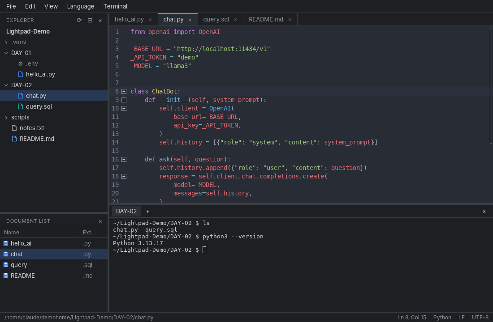

- **Explorer** (top left): the open folder as a tree. Click a file to open it; the keyboard stays in the explorer, so Delete, F2 and Ctrl+C act on that file. Double-click a file, or press Enter, to start typing in it.
- **Document List** (bottom left): every open file. Click a column head to sort by
  name or extension. The disk icon is blue when the file is saved and red when it
  has unsaved changes.
- **Tabs and editor** (top right): one tab per file, with line numbers and fold boxes
  in the margin.
- **Terminal** (bottom right): a real shell (cmd on Windows) opened in the file's folder.
- **Status bar**: file path, zoom level, cursor position, language, line endings
  (LF/CRLF) and encoding. Click the language to change it.

The first time you run Lightpad there is no folder open yet:

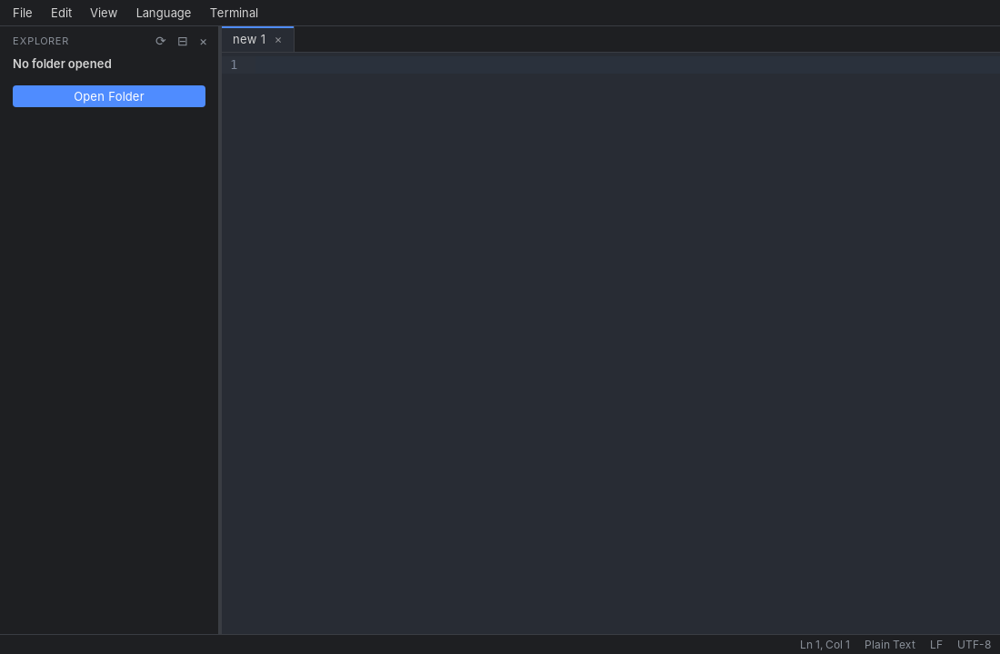

Use **File > Open Folder** (Ctrl+Shift+O), or drag a folder onto the window.
Lightpad remembers the folder and your open tabs, including unsaved edits, the next
time it starts.

## File menu

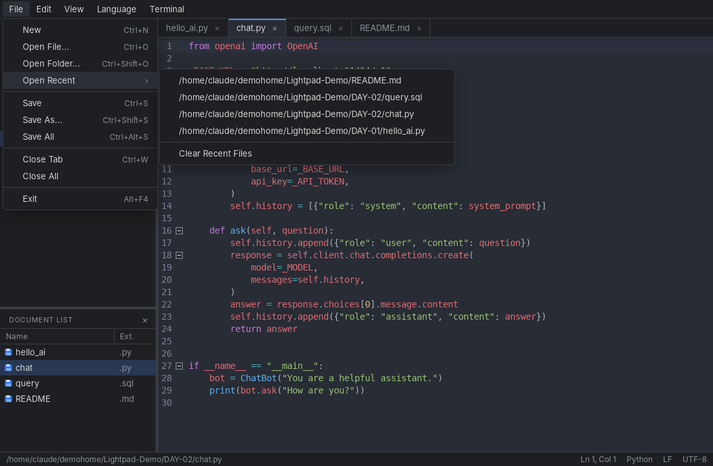

| Item | Keys | What it does |
| --- | --- | --- |
| New | Ctrl+N | New untitled tab |
| Open File... | Ctrl+O | Open one or more files |
| Open Folder... | Ctrl+Shift+O | Show a folder in the explorer |
| Open Recent | | Recently opened files, and Clear Recent Files |
| Save | Ctrl+S | Save the current tab |
| Save As... | Ctrl+Shift+S | Save under a new name |
| Save All | Ctrl+Alt+S | Save every modified tab |
| Close Tab | Ctrl+W | Close the current tab (asks before discarding changes) |
| Close All | | Close every tab except pinned ones |
| Exit | Alt+F4 | Quit (asks about unsaved changes) |

## Edit menu

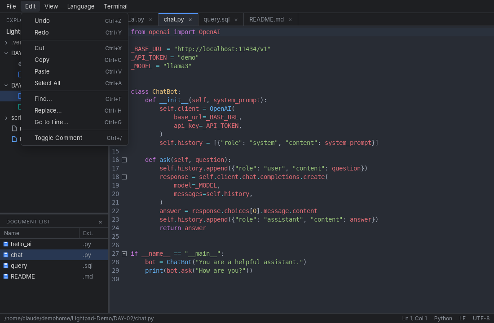

Undo, Redo, Cut, Copy, Paste and Select All, plus:

| Item | Keys |
| --- | --- |
| Find... | Ctrl+F |
| Replace... | Ctrl+H |
| Go to Line... | Ctrl+G |
| Toggle Comment | Ctrl+/ |

To comment several lines at once, select them and press **Ctrl+/** (the / on the number pad works
too). Every line the selection touches gets the language's comment mark: `#` in Python, `//` in
JavaScript and C#, `--` in SQL, `REM` in batch files. Press Ctrl+/ again to uncomment them.
Shift+Alt+A wraps the selection in a block comment such as `/* ... */`.

## View menu

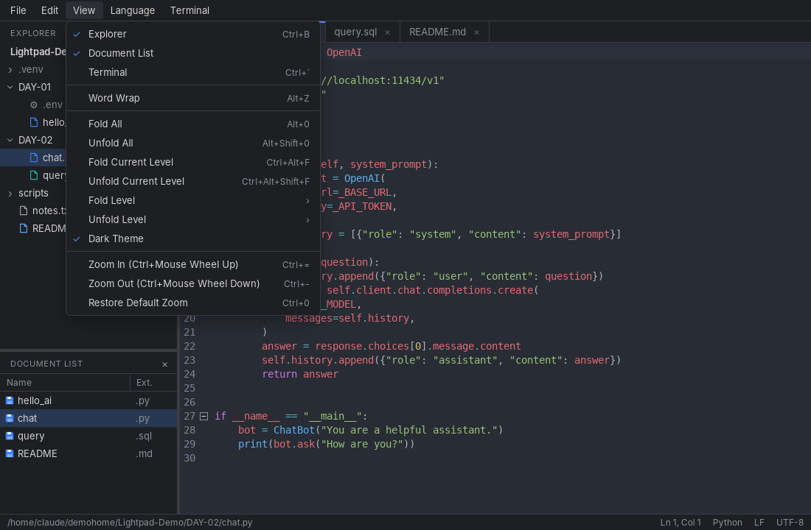

| Item | Keys | What it does |
| --- | --- | --- |
| Explorer | Ctrl+B | Show or hide the explorer |
| Document List | | Show or hide the list of open files under the explorer |
| Terminal | Ctrl+` | Show or hide the terminal panel |
| Word Wrap | Alt+Z | Wrap long lines |
| Dark Theme | | Switch between dark and light |
| Fold All / Unfold All | Alt+0 / Alt+Shift+0 | Collapse or expand every block |
| Fold / Unfold Current Level | Ctrl+Alt+F / Ctrl+Alt+Shift+F | Collapse or expand the block at the cursor |
| Fold Level / Unfold Level | Alt+1..8 / Alt+Shift+1..8 | Collapse or expand every block at one depth |
| Zoom In / Zoom Out | Ctrl+= / Ctrl+- | Zoom the editor |
| Restore Default Zoom | Ctrl+0 | Reset the editor zoom |

Fold Level and Unfold Level open a submenu of levels 1 to 8:

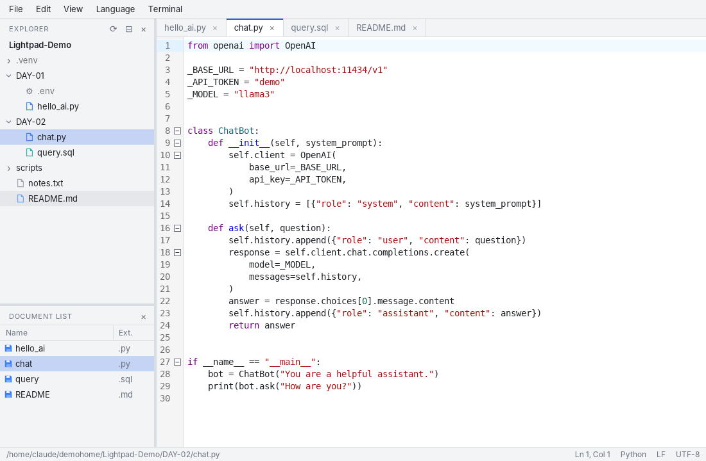

## Language menu

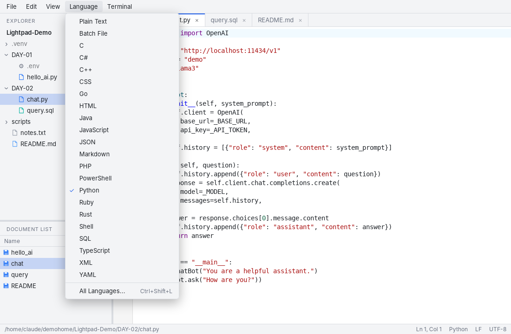

The language is picked from the file name when you open a file. The menu lists the
common languages; **All Languages...** (Ctrl+Shift+L, or click the language in the
status bar) opens a searchable list of 140+:

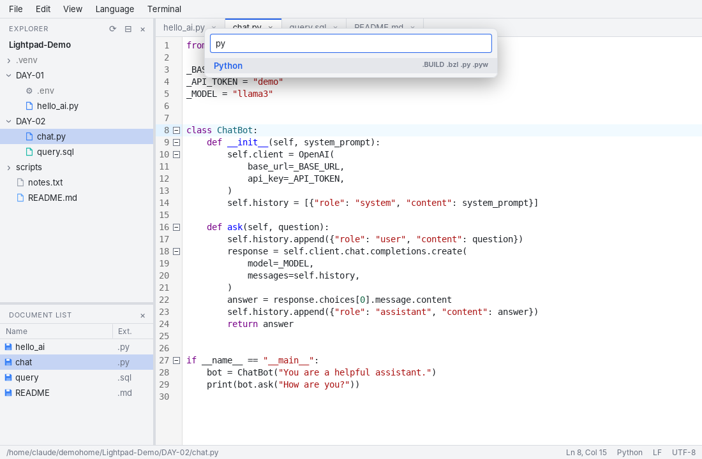

Type part of a name or an extension (here `py`) and press Enter.

## Terminal menu

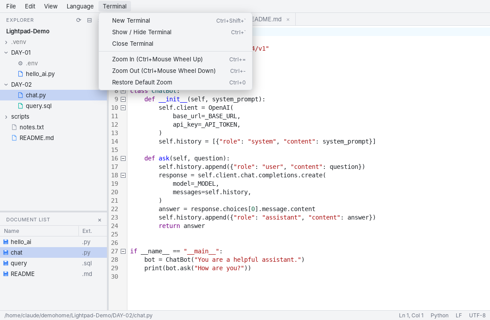

| Item | Keys | What it does |
| --- | --- | --- |
| New Terminal | Ctrl+Shift+` | Open another terminal tab |
| Show / Hide Terminal | Ctrl+` | Toggle the panel |
| Close Terminal | | Close the current terminal tab |
| Zoom In / Out / Restore | Ctrl+= / Ctrl+- / Ctrl+0 | Zoom the terminal, separately from the editor |

In the terminal, copy with Ctrl+Shift+C and paste with Ctrl+Shift+V. On Windows,
use `cd /d D:\path` to change to a folder on another drive, or right-click a folder
in the explorer and choose **Open in Terminal**.

## Window menu and switching files

Press **Ctrl+Tab** to jump back to the file you used before, like Alt+Tab in Windows. Press it
again to return. To go further back, hold Ctrl and tap Tab: a list of open files appears, most
recently used first, and letting go of Ctrl opens the highlighted one. Ctrl+Shift+Tab moves up the
list, and Escape closes it without switching. Files with unsaved changes have a red dot.

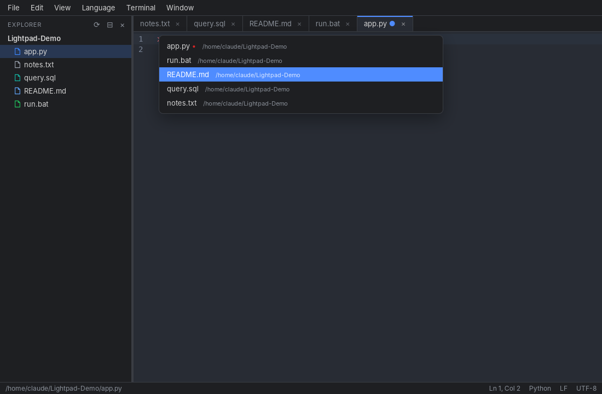

| Keys | What it does |
| --- | --- |
| Ctrl+Tab / Ctrl+Shift+Tab | Switch files, most recently used first |
| Ctrl+PgDn / Ctrl+PgUp | Next / previous tab, in tab-bar order |
| Ctrl+1 to Ctrl+8 | Go to that tab |
| Ctrl+9 | Go to the last tab |

These work from the editor, the explorer and the terminal. The **Window** menu (Alt+W) has the
same commands and lists every open file:

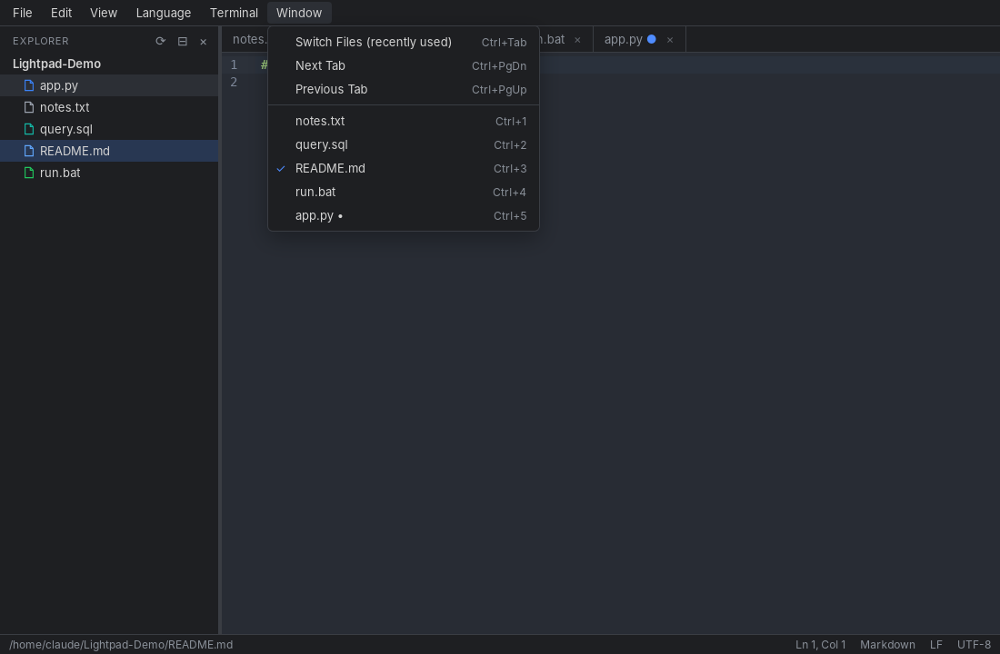

## Explorer

Right-click a file:

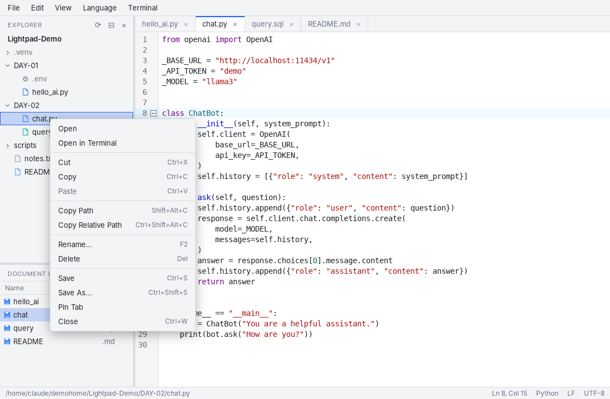

| Item | Keys | What it does |
| --- | --- | --- |
| Open | Enter | Open the file in a tab |
| Open in Terminal | | New terminal in the file's folder |
| Cut / Copy / Paste | Ctrl+X / Ctrl+C / Ctrl+V | Move or copy files and folders. A name clash gets " - Copy" added, nothing is overwritten |
| Copy Path | Shift+Alt+C | Copy the full path |
| Copy Relative Path | Ctrl+Shift+Alt+C | Copy the path from the open folder |
| Rename... | F2 | Rename in place (open tabs follow the new name) |
| Delete | Delete | Move to the Recycle Bin, after asking |
| Save / Save As... | | Save the file's open tab |
| Pin Tab | | Keep the tab first and protect it from Close All |
| Close | | Close the file's tab |

Right-click a folder for **New File**, **New Folder** and **Open in Terminal**, plus
the same clipboard, path, rename and delete items:

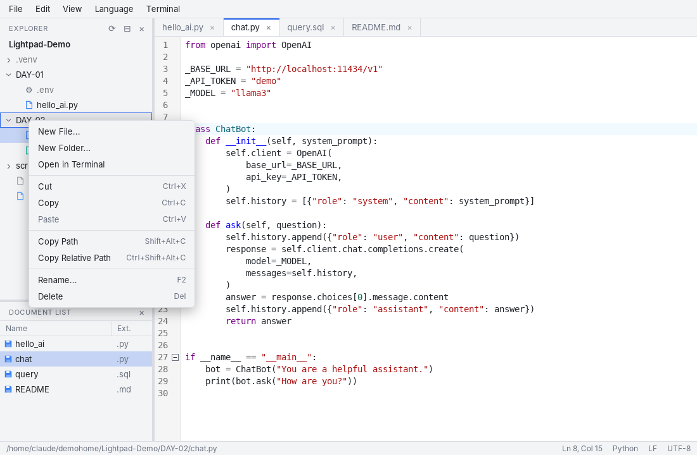

Rename and New File ask for a name. The name is selected without its extension, so
you can type straight over it:

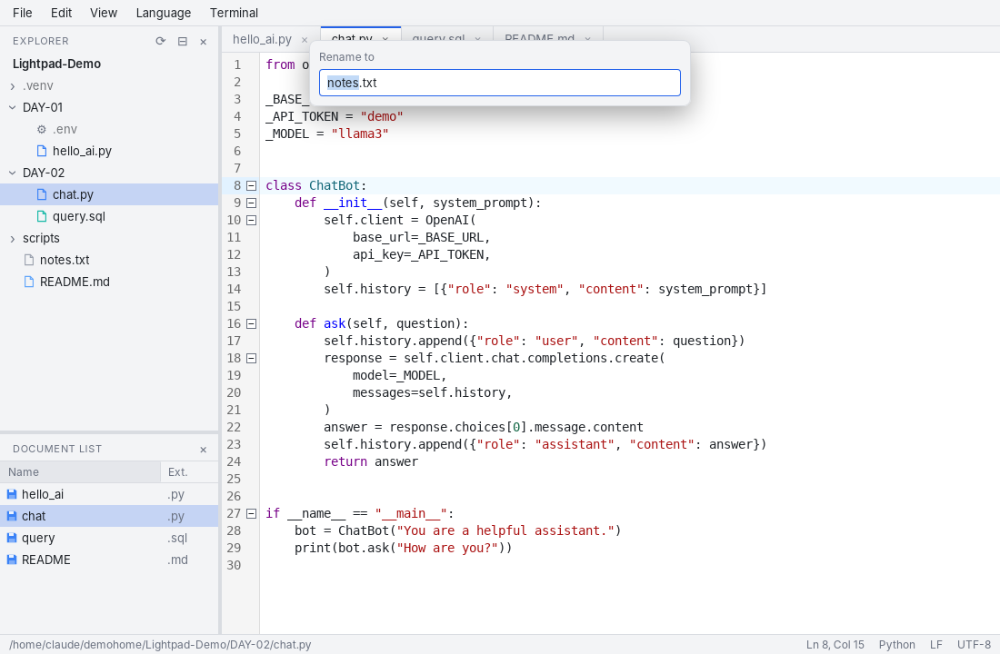

The explorer's header has buttons to refresh, collapse all folders and close the pane.

## Code folding

Click a **−** box in the margin to fold a block; it turns into **+** and the folded
line shows `⋯`. Click **+** or the `⋯` to unfold. Folding works on indented code
(Python, YAML) and on anything in brackets. Here, **Fold Level 2** (Alt+2) has
collapsed every method:

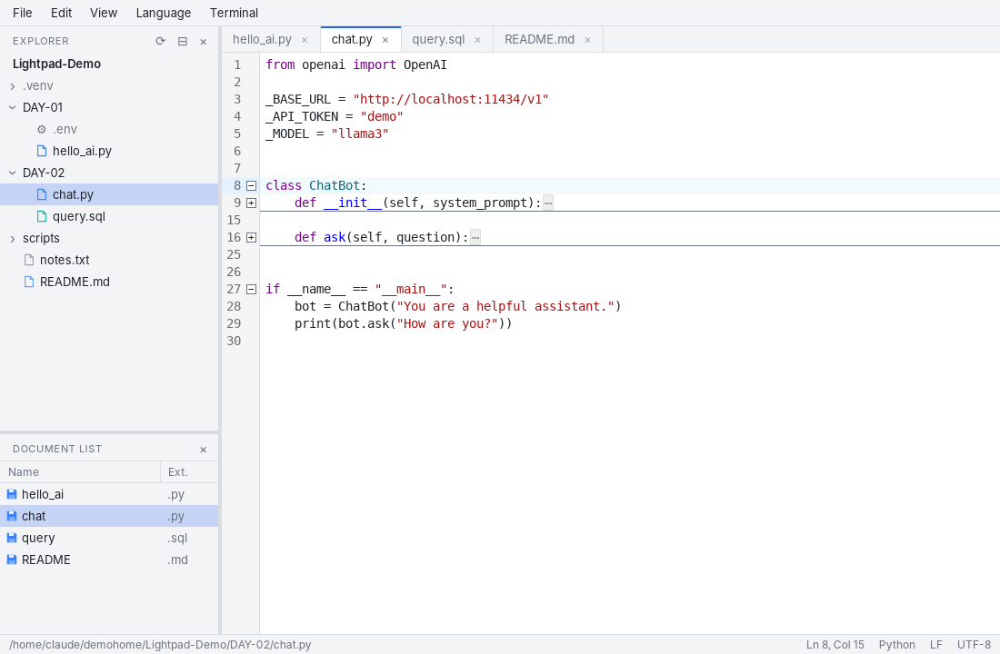

## Find and replace

Ctrl+F opens find, Ctrl+H opens find and replace. Options: match case, regular
expression and whole word. Enter finds the next match.

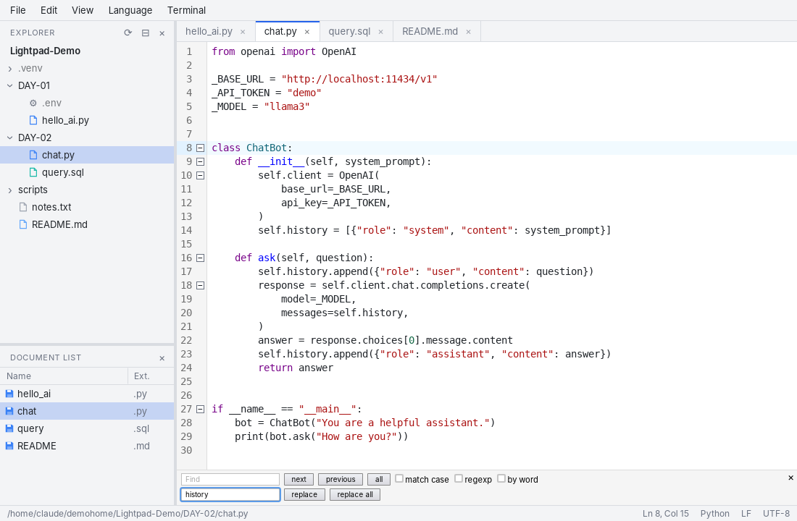

## Zoom and themes

The editor and the terminal zoom separately. Ctrl+= and Ctrl+- zoom whichever pane
has focus, and Ctrl+mouse wheel zooms the pane under the mouse. The status bar shows
both levels. Here the editor is at 121% and the terminal at 92%, in the light theme
(View > Dark Theme turns dark mode off and on):

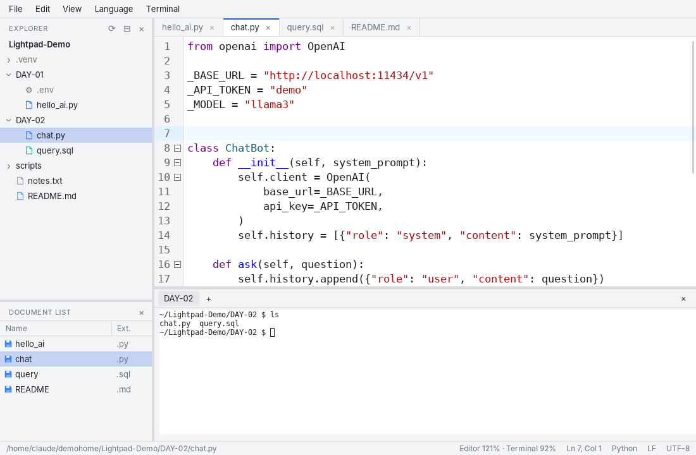
